# Ludvík

A short narrative exploration game made with three.js. You wake up in an empty classroom on the first day of school.
The school floats in a darkness with no stars, someone keeps writing kind notes on the blackboard, and your memories
don't quite agree with each other. Slovak and English.

**Play:** <https://m1omg.github.io/Ludvik/>

Best with headphones. Desktop: mouse to look, `WASD` to fly, `Space`/`C` up and down, `Shift` faster, `E` examine,
`J` journal, `M` sound, `Esc` pause. Touch: drag the left half to fly, the right half to look, tap to examine.

## What's new in this version

### 3D models made with Higgsfield

The characters and the most important objects used to be built from cylinders, spheres and boxes. They are now
real 3D models, generated with [Higgsfield](https://higgsfield.ai):

1. **Concept art** for every model with GPT Image 2.6, as a full-body or full-object render on a plain background.
2. **Image to 3D:** Tripo H3.1 for the two main characters (best detail), SAM 3D for the classmates and props.
3. **Optimised for the web** with `tools/model-pipeline`: turned to face +Z, standing on y = 0, scaled to metres,
   simplified, WebP textures and meshopt compression. All 14 models together are 2.6 MB.

| Model | Higgsfield model | Triangles | Size | Where |
| --- | --- | ---: | ---: | --- |
| Caretaker (Ondrej) | Tripo H3.1 | 30 000 | 323 KB | boiler room, endings |
| Ema | Tripo H3.1 | 26 000 | 346 KB | the Caretaker ending |
| Broom | SAM 3D | 5 237 | 153 KB | in the caretaker's hand |
| Classmate (boy) | SAM 3D | 7 374 | 145 KB | the New Universe ending |
| Classmate (girl) | SAM 3D | 14 579 | 241 KB | the New Universe ending |
| Upright piano | SAM 3D | 9 999 | 158 KB | corridor (memory) |
| Child's bicycle | SAM 3D | 8 948 | 238 KB | the void (memory) |
| Indoor slipper (×2) | SAM 3D | 4 298 | 123 KB | cloakroom (memory) |
| Apple | SAM 3D | 3 000 | 48 KB | classroom (memory) |
| Dog collar | SAM 3D | 4 000 | 129 KB | cloakroom (memory) |
| Football | SAM 3D | 5 296 | 130 KB | schoolyard (memory) |
| Telescope | SAM 3D | 7 327 | 186 KB | roof (clue) |
| Valve radio | SAM 3D | 6 000 | 129 KB | caretaker's room |
| Rotary telephone | SAM 3D | 5 964 | 203 KB | headmaster's office |

Small story details survive the swap. The two slippers are the same model twice, so they really are *both left ones*.
The apple is red on one half and green on the other, because Ludvík remembers both colours at once.

<p>
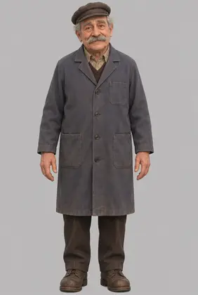
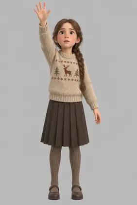
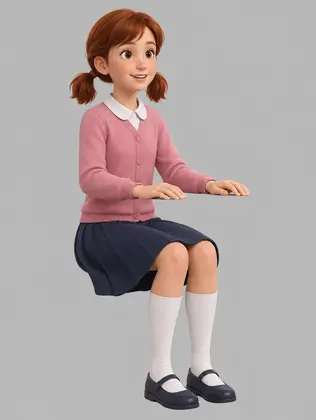
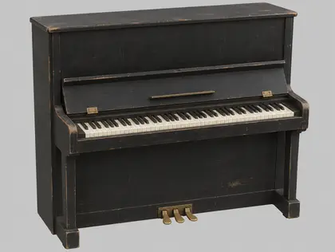
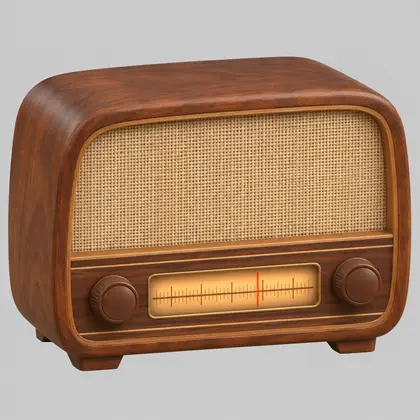
</p>

### Ghosts made of chance

The caretaker and Ema are Boltzmann brains: minds that a random fluctuation assembled out of chaos for a moment.
They are drawn as light instead of matter, using a two-pass shader. A depth pre-pass stops the translucent body from
showing its own inner walls, then a colour pass adds:

* **rim light** in each character's colour (warm amber for the caretaker, violet for Ema),
* a **faint memory of their colours**: the model's texture, desaturated and tinted, so faces and clothes read through,
* **fluctuation holes** in slowly drifting 3D noise, with glowing edges. There are more of them at the feet, and many
  more as a character fades, so when the caretaker leaves he comes apart into chaos again,
* a gentle **breathing** of the surface and rare **glitches**, where a horizontal band of the body slips sideways for
  a split second,
* **sparks** sampled from the model's surface that evaporate and drift away.

Everything is driven by game time, never by frame count, so the effect looks the same at 30, 60 or 144 Hz.
The classmates in the new universe are real children, so they stay solid.

| Before | After |
| --- | --- |
| 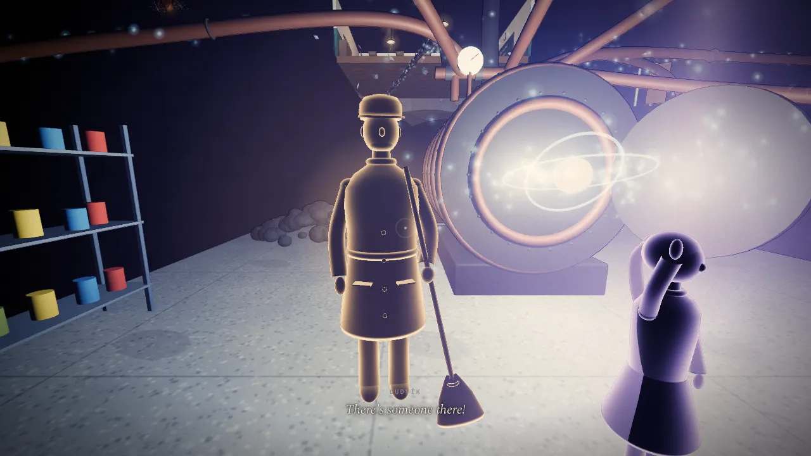 | 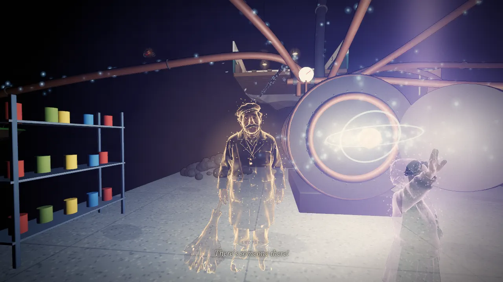 |
| 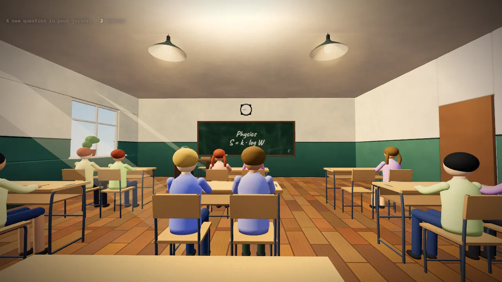 | 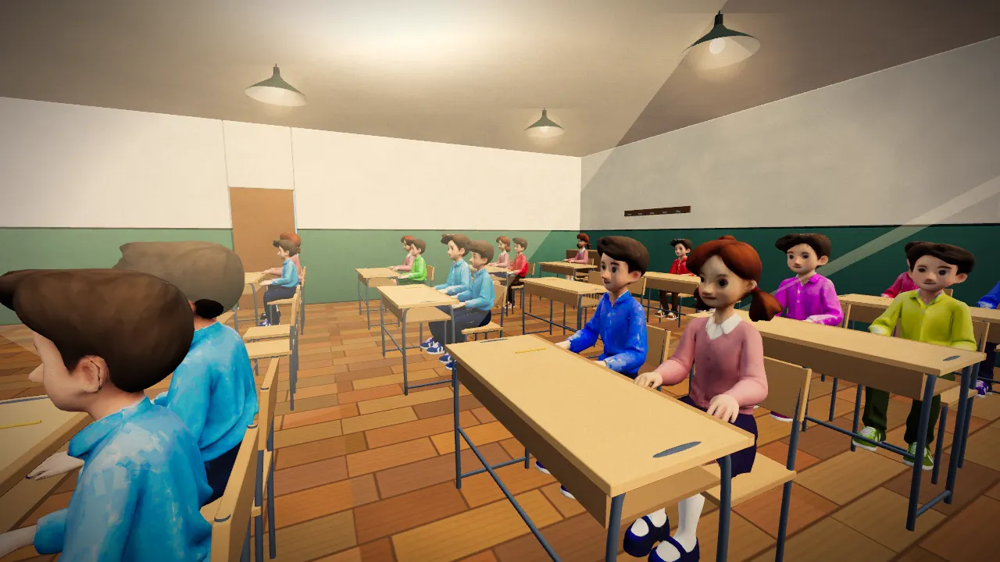 |

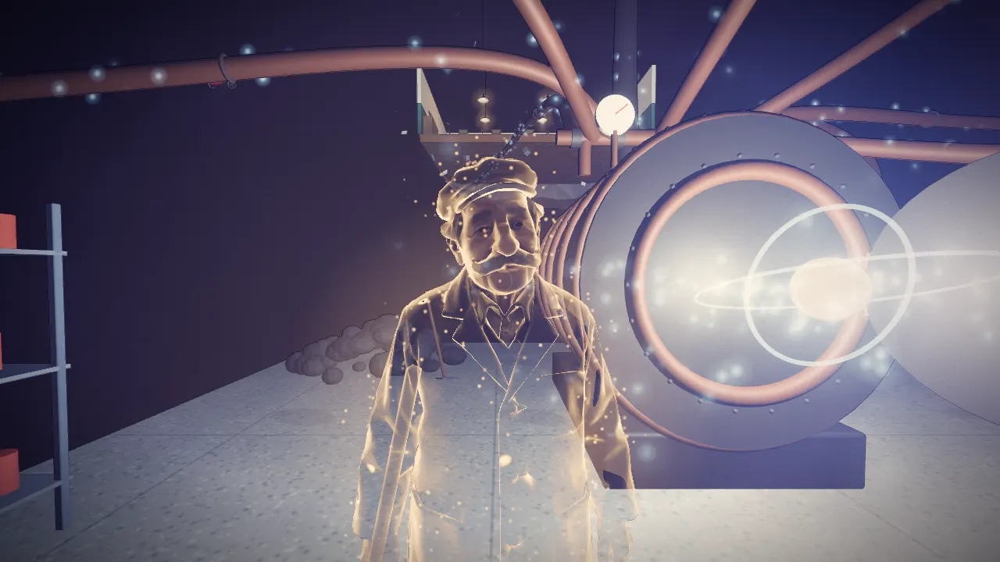
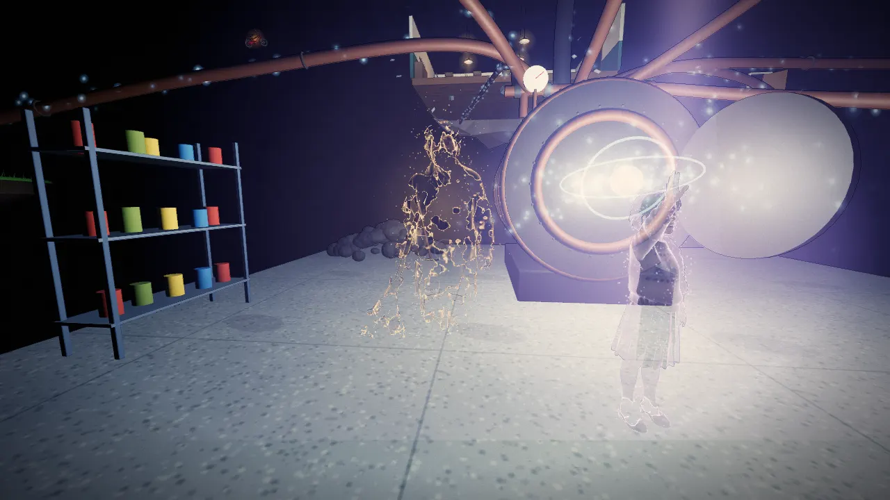
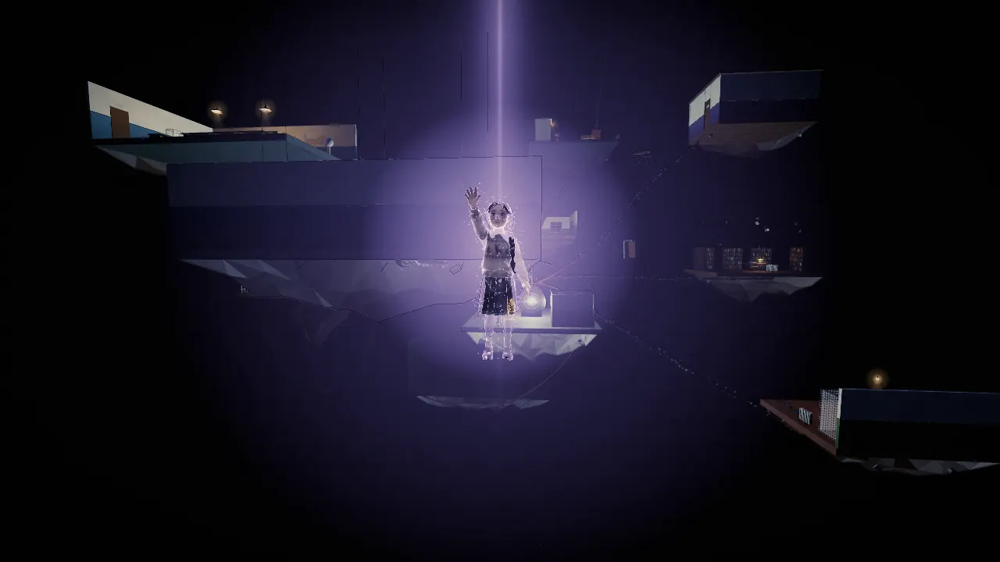

### Robustness

* three.js r160 (the same version as before) is bundled in `vendor/`, so the game no longer depends on a CDN.
* Models load in parallel with the fonts. The game waits at most 9 s for them; any that arrive later are swapped in
  live. If a model fails to load, the original procedural shape is used (the characters still get the ghost shader).

## Running locally

ES modules and model files need a web server; opening `index.html` straight from disk won't work.

```sh
python3 -m http.server 8000
# open http://localhost:8000
```

## Deployment

`.github/workflows/pages.yml` publishes `index.html`, `models/` and `vendor/` to GitHub Pages on every push.
The first time, the repository's Pages source must be set to **GitHub Actions**
(Settings → Pages → Build and deployment → Source).

## Rebuilding the models

`tools/model-pipeline` reproduces `models/` from the raw GLB exports (download them from your Higgsfield
generation history into `tools/model-pipeline/raw/` under the names listed in `models.json`):

```sh
cd tools/model-pipeline
npm install
npm run build          # or: node process.mjs models.json piano radio
```

## Credits

* Game: the repository owner. Models generated with Higgsfield (GPT Image 2.6, Tripo H3.1, SAM 3D).
* [three.js](https://threejs.org) r160, MIT licence (`vendor/three/LICENSE`).
* Fonts from Google Fonts: Caveat, Cormorant Garamond, IBM Plex Mono, Spectral.
